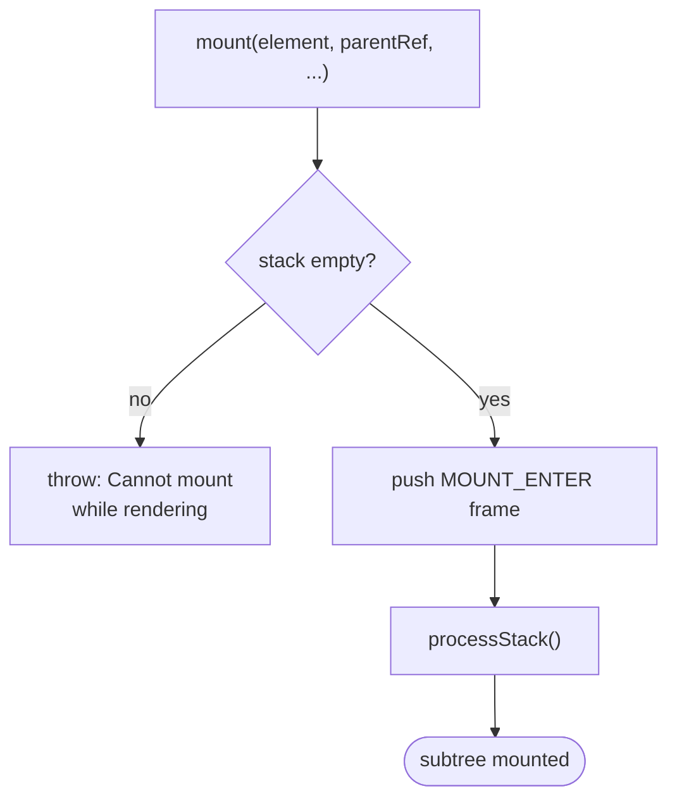
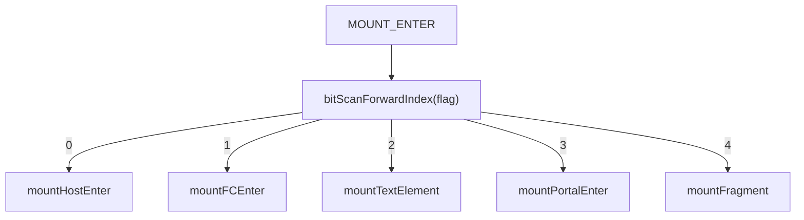
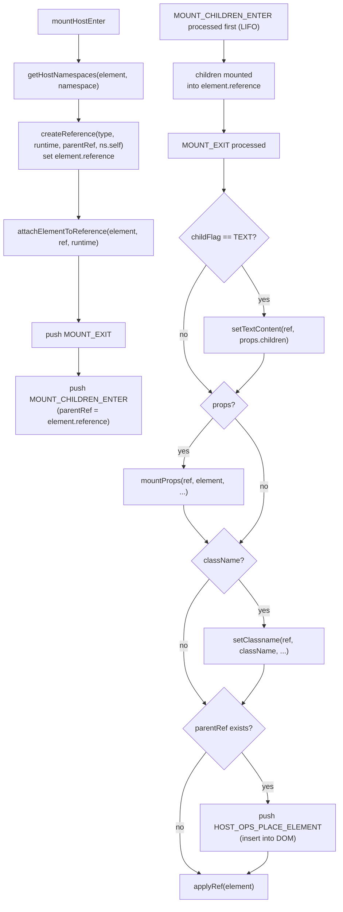
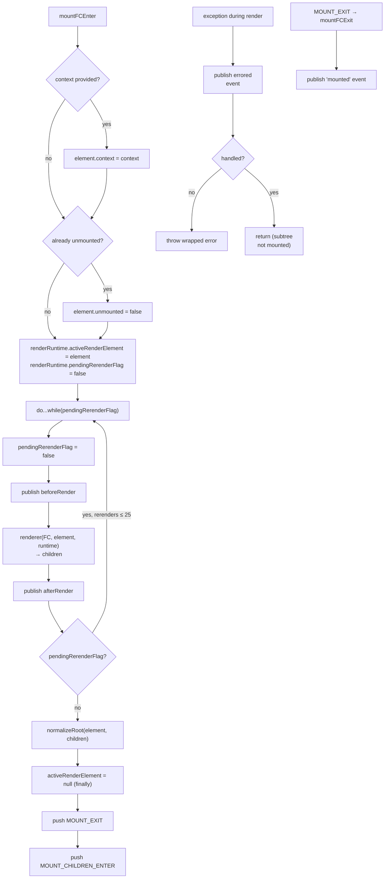
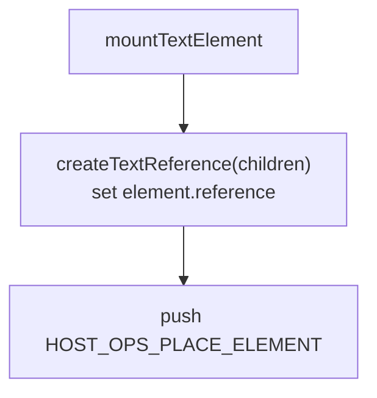
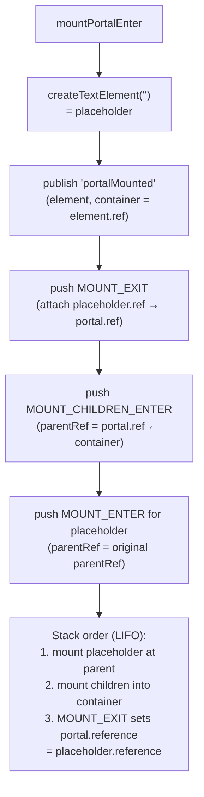
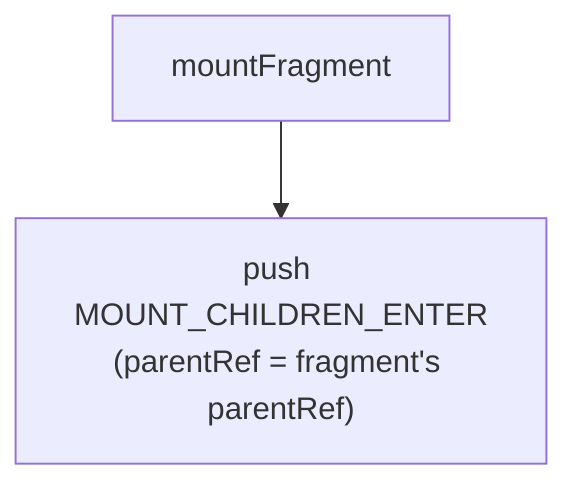
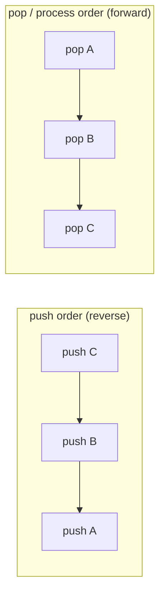

# Mounting

Mounting attaches a new element subtree to the host environment for the first time.

**Entry point:** `mount(element, parentReference, subtreeRightBoundary, context, hostNamespace, renderRuntime)`

The function asserts the render stack is empty, pushes one `MOUNT_ENTER` frame, then calls `processStack`. Every subsequent frame is pushed by the handlers themselves — mount is fully iterative.

## Top-level flow

## Per-type handlers (MOUNT_ENTER dispatch)

The `flag` field determines which handler runs. `bitScanForwardIndex(flag)` converts the single set bit into an array index `[HOST=0, FC=1, TEXT=2, PORTAL=3, FRAGMENT=4]`.

### HOST (`mountHostEnter`)

**Hydration.** `createReference`/`createTextReference` take `renderRuntime` and `parentReference` so the host adapter can adopt an existing DOM node instead of always creating one. `domAdapter`'s implementation (`src/main/dom/domAdapter.ts`) checks `isHydrating(renderRuntime)`: while hydrating, it walks a per-parent cursor over the real DOM's existing children (seeded from `parentReference.firstChild`), matching each element by tag name / each text node by node type. On a match, the cursor advances and the existing node is reused. On a mismatch, it warns once per parent and falls back to creating a fresh node, leaving the mismatched candidate available for a later sibling to still match against.

### FC (`mountFCEnter`)

State updates triggered during the render itself (e.g. a `useState` setter called from a derived value) call `rerender(element, runtime)`, which sees `renderRuntime.activeRenderElement === element` and just sets `pendingRerenderFlag = true` instead of queuing — no event is published for this case. The `do...while` loop checks the flag after `afterRender` and re-runs immediately if set. Up to 25 re-render loops are allowed before throwing. See [rerender.md](./rerender.md).

### TEXT (`mountTextElement`)

TEXT elements have no EXIT frame — placement is the only post-creation operation.

### PORTAL (`mountPortalEnter`)

A portal renders its children into an external container while inserting an empty text placeholder node at the portal's logical position in the tree.

The `portalMounted` event is consumed by the DOM layer's hydration bookkeeping (`hydrationState.ts`) to exclude the portal's container from the parent's hydration-cursor matching, since the container is external to the document position where the portal element itself sits.

### FRAGMENT (`mountFragment`)

Fragments have no host reference. Children are mounted directly at the parent's position.

## Child ordering

`mountChildren` pushes child `MOUNT_ENTER` frames in **reverse order** so that when `processStack` pops them it processes them in forward (left-to-right) order. Each child also receives a `subtreeRightBoundary` pointing to its right sibling, which the eventual `HOST_OPS_PLACE_ELEMENT` uses to `insertBefore` the correct anchor.

